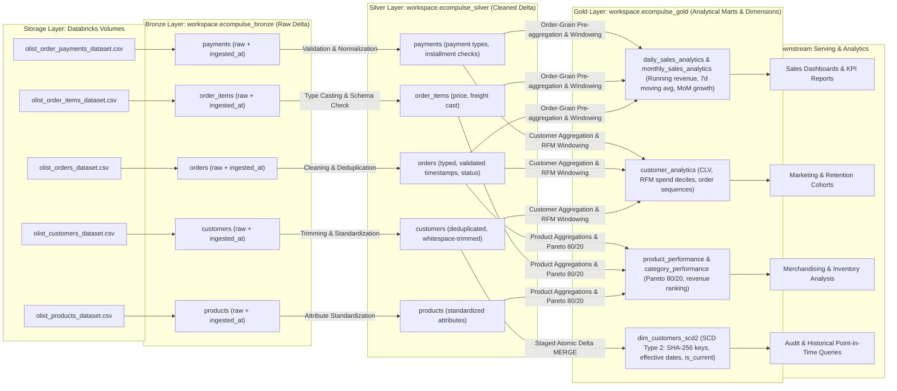
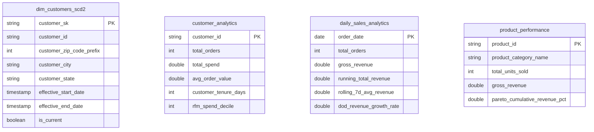
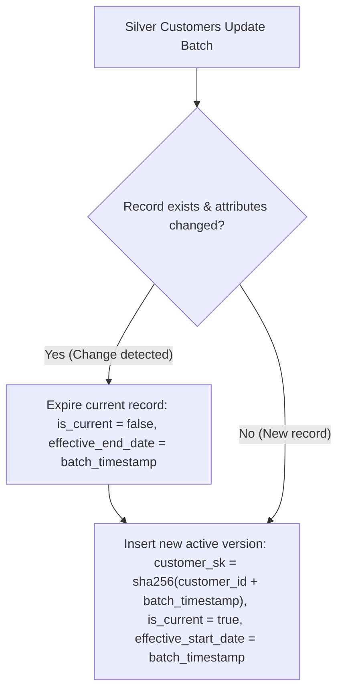

# Ecommerce Data Pipeline: Medallion Lakehouse

End-to-end Lakehouse batch ETL pipeline implementing the Medallion architecture (Bronze, Silver, Gold) and Slowly Changing Dimensions (SCD Type 2) using PySpark and Delta Lake on Databricks Unity Catalog.

## Architecture and Data Flow



## Directory Structure

```text
Ecommerce Data Pipeline/
├── bronze/
│   └── bronze_ingestion.ipynb        # Ingests raw CSVs into Bronze Delta tables
├── silver/
│   ├── silver_customers.ipynb       # Customer cleaning and deduplication
│   ├── silver_orders.ipynb          # Order timestamps and status normalization
│   ├── silver_order_items.ipynb     # Line item calculations and type casting
│   ├── silver_payments.ipynb        # Payment methods and installment validation
│   └── silver_products.ipynb        # Product dimension standardizations
├── gold/
│   ├── gold_sales_analytics.ipynb   # Daily/monthly revenue, 7d moving avg, MoM growth
│   ├── gold_customer_analytics.ipynb# Customer LTV, order tenure, RFM deciles
│   ├── gold_product_analytics.ipynb # Item volumes, category Pareto 80/20 analysis
│   └── gold_scd2_dimensions.ipynb   # dim_customers_scd2 Delta MERGE and time travel
└── tests/
    ├── run_e2e_tests.py             # 4-tier E2E validation runner
    ├── test_e2e_lakehouse.py        # Schema, window function, and MERGE tests
    └── lakehouse_test_utils.py      # Notebook AST parser and Spark mocks
```

## Data Models



## Pipeline Layers

### Bronze (`workspace.ecompulse_bronze`)
- Ingests source CSV files from volume storage into append/overwrite Delta tables.
- Preserves raw schema and tracks ingestion metadata (`ingested_at`).

### Silver (`workspace.ecompulse_silver`)
- Type casting, whitespace trimming, and null handling.
- Timestamp derivations and order status standardization.
- Deduplication on primary keys (`order_id`, `customer_id`, `product_id`).

### Gold (`workspace.ecompulse_gold`)
- **Sales Analytics**: Daily and monthly aggregations with anti-fanout pre-aggregation. Uses PySpark window functions for running revenue totals, 7-day rolling moving averages, and DoD / MoM growth rates.
- **Customer 360**: Computes Customer Lifetime Value (CLV), purchase frequency, tenure, and RFM spend deciles via `NTILE(10)` and `DENSE_RANK()`.
- **Product & Category Performance**: Aggregates unit sales, revenue volume, and category share via cumulative Pareto 80/20 distribution.

### Slowly Changing Dimensions (SCD Type 2)



- Target table: `workspace.ecompulse_gold.dim_customers_scd2`.
- Tracks location changes (`customer_city`, `customer_state`, `customer_zip_code_prefix`).
- Staged atomic Delta `MERGE` (`whenMatchedUpdate` for expired versions, `whenNotMatchedInsert` for new entries).
- Watermark incremental loading to process only updated records.
- Delta Lake features: Schema enforcement, schema evolution (`mergeSchema`), time travel (`VERSION AS OF` / `TIMESTAMP AS OF`), and table audit (`DESCRIBE HISTORY`).
